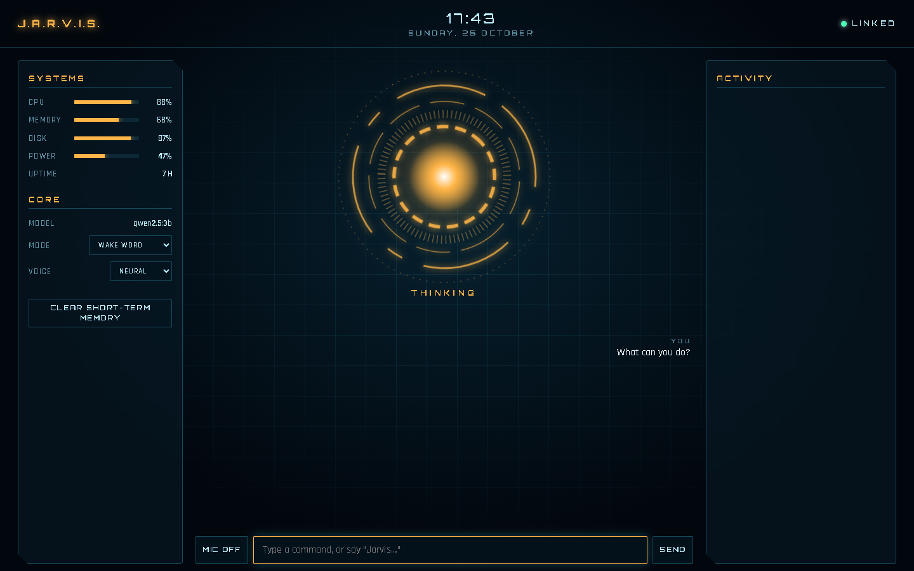

# J.A.R.V.I.S.

A local, voice-controlled assistant for Windows. The brain is an LLM running in [Ollama](https://ollama.com) on your
own machine, with tool calling for the PC, files, the web, long-term memory and Gmail/Calendar. The HUD is a
sci-fi dashboard that opens in Edge.

Built with **Python (FastAPI + WebSockets)**, **Ollama (qwen2.5)**, **edge-tts**, and vanilla **HTML/CSS/JS**.



```
 mic ─► Edge speech recognition ─► HUD ──WebSocket──► server.py ──► brain.py ──► Ollama (qwen2.5:3b)
                                     ▲                                  │
 speakers ◄── edge-tts neural voice ─┘                                  └──► tools/ (PC, files, web, memory, Google)
```

## Install

Requires Windows, Python 3.10+ and [Ollama](https://ollama.com/download).

```powershell
python -m venv .venv
.venv\Scripts\pip install -r requirements.txt
```

## Start

Double-click **`Start JARVIS.bat`**. It starts Ollama, downloads the model the first time (~2 GB),
starts the server and opens the HUD. Click **MIC** and allow the microphone.

| Mode | How |
|---|---|
| Wake word | Say “Jarvis, what's the weather?” — or “Jarvis” and wait for the chime |
| Always listen | Everything you say is a command |
| Push to talk | Click the reactor (or **Ctrl+Space**), then speak |

**Esc** stops it talking / cancels. Clicking the reactor while it speaks interrupts it.

## What it can do

| Area | Tools |
|---|---|
| PC | open apps & websites, media/volume keys, lock screen, system status, run PowerShell* |
| Files & code | write/read/list/open files — anything in `workspace/` freely, elsewhere* |
| Web | web search, read a page, weather, news headlines |
| Memory | remember / recall / forget* facts; every conversation is logged in `data/jarvis.db` |
| Gmail & Calendar | check email, draft emails*, upcoming events (after setup below) |

\* asks for your authorisation first (say “yes”/“no” or click). It can draft emails but never sends them.

## Settings

Edit the commented lines at the top of `start-jarvis.ps1` — e.g. `JARVIS_CITY`, `JARVIS_NEWS_REGION`,
`JARVIS_USER_TITLE`, `JARVIS_VOICE`. All options are in `jarvis/config.py`.

**Model choice.** It's tuned to run on a laptop CPU with no dedicated GPU:
- `qwen2.5:3b` (default) — replies in a few seconds, handles tools reasonably.
- `qwen2.5:7b` — clearly smarter, roughly twice as slow. Set `$env:JARVIS_MODEL = "qwen2.5:7b"`.

## Connect Gmail & Calendar (optional, ~5 minutes)

1. Go to <https://console.cloud.google.com/> → create a project.
2. **APIs & Services → Library**: enable **Gmail API** and **Google Calendar API**.
3. **OAuth consent screen**: External, add your own address as a test user.
4. **Credentials → Create credentials → OAuth client ID → Desktop app**. Download the JSON and save it as
   `data/google_credentials.json`.
5. Run once, and sign in in the browser window that opens:
   ```
   .venv\Scripts\python -m jarvis.tools.google
   ```
6. Restart JARVIS. The Gmail/Calendar tools now appear.

## Privacy notes

- The model, your memory database and your files stay on your PC.
- **Speech recognition** uses Edge/Chrome's built-in service, which sends your audio to Microsoft/Google
  to transcribe. The **voice** (edge-tts) sends JARVIS's replies to Microsoft to synthesise; pick
  VOICE → BROWSER in the HUD to keep that offline. Fully offline speech (Whisper + Piper) is a natural next step.
- Web tools contact DuckDuckGo/Bing, wttr.in and Google News.

## Adding a tool

Drop a function into any file in `jarvis/tools/`:

```python
@tool("What it does, for the model.", {"city": string("City name")})
def my_tool(city: str) -> str:
    return "result text the model will read"
```

Add `confirm=True` if it should ask before running. Restart the server.
